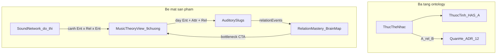
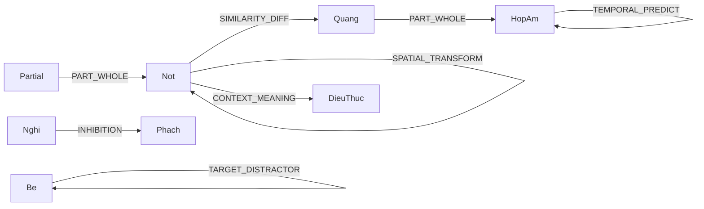
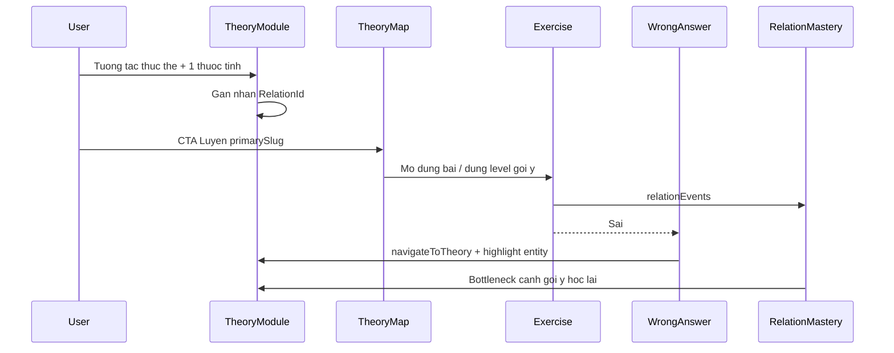

# Plan: Lý thuyết âm nhạc theo Thực thể · Thuộc tính · Quan hệ

Tài liệu nền đã có trong repo (plan này **hợp nhất + căn chỉnh** chúng cho bề mặt Lý thuyết, không thay ADR):

- [ADR-001-COGNITIVE-RELATION-ENGINE.md](docs/ADR-001-COGNITIVE-RELATION-ENGINE.md) — 12 quan hệ là đơn vị huấn luyện
- [KE_HOACH_AM_NHAC_THUOC_TINH_QUAN_HE.md](KE_HOACH_AM_NHAC_THUOC_TINH_QUAN_HE.md) — ontology nhạc + thuộc tính còn thiếu
- [exercise-relation-map.ts](shared/src/cognition/exercise-relation-map.ts) — map slug → primary/secondary/levelAffinity
- [MusicTheoryView.tsx](frontend/src/components/learn/MusicTheoryView.tsx) — 9 chương Interactive Ear Academy

---

## 0. Triết lý cốt lõi (trải nghiệm phát triển)

Người dùng không “đọc xong chương” — họ **nhìn thấy đối tượng nhạc**, **thay một thuộc tính**, **cảm một quan hệ nhận thức**, rồi **luyện đúng bài** và **sửa sai trên đúng cạnh**.

| Nguyên tắc | Hệ quả UX |
|---|---|
| Quan hệ 12 gốc là xương sống | Brain Map / recommend-chain dùng chung với bài thị giác; lý thuyết nhạc **gắn nhãn quan hệ** (không invent “HARMONIC_RHYTHM” làm relation mới) |
| Thực thể nhạc là domain object, không bảng SQL | Piano, block hợp âm, rest, bè… sống trong generator + UI lý thuyết |
| Thuộc tính = núm vặn trải nghiệm | Mỗi demo lý thuyết đổi **đúng 1 thuộc tính** để mặt quan hệ nổi |
| Learn → Practice → Remediate → Mastery | Deep-link 2 chiều; checkmark = nắm cạnh, không = đã mở tab |
| Không nổ scope | Không 10 game mới; không ERD `notes`/`chords`; tối đa giữ slug `voice-track` đã có |



---

## 1. Ontology: đừng nhầm 3 tầng

| Tầng | Là gì | Ví dụ | Lưu / hiện ở đâu |
|---|---|---|---|
| **Thực thể nhạc** | Đối tượng chỉ vào được | Nốt, Nghỉ, Phách, Quãng, Hợp âm, Điệu thức, Bè, Motif, Câu, Partial, Nguồn không gian | Generator + UI lý thuyết + `answerKey` — **không** bảng Postgres |
| **Thuộc tính (HAS-A)** | Giá trị trên 1 thực thể | `midi`, `cents`, `velocity`, `dur`, `pan`, `articulation`, `rest`, `partialGains`, `layer`, `reverbWet` | Mở rộng trên stimulus/`AudioEvent` (xem KE_HOACH §6) |
| **Quan hệ nhận thức (ADR)** | Não giữ liên kết nào | 12 `RelationId` cố định | [relations.ts](shared/src/cognition/relations.ts) + `relationEvents[]` + Brain Map |

**Ràng buộc cứng (giữ nguyên KE_HOACH §11):**

1. Không thêm bảng SQL cho Nốt/Hợp âm/Scale.
2. Không thêm quan hệ thứ 13 — “nhịp hòa âm”, “voice leading” là **cặp thực thể**, map vào `TEMPORAL_PREDICT` / `SPATIAL_TRANSFORM` / `CONTEXT_MEANING`.
3. Mỗi ý tưởng mới phải trả lời: thuộc tính nào? quan hệ ADR nào? slug nào (hay bắt buộc slug mới)?
4. Copy khoa học: paradigm (relative pitch, streaming, meter induction) — không claim giải phẫu.

---

## 2. Audit thực thể & quan hệ hiện có (cần chỉnh)

### 2.1 Thực thể nhạc đã “có mặt” trên UI lý thuyết

| Chương | Thực thể chính đang dạy | Thuộc tính đang expose | Quan hệ ADR nên gắn (để UX nói đúng) | Primary slug hiện tại |
|---|---|---|---|---|
| `notes` | Nốt | freq/midi (bảng tĩnh), contour demo | `ORDER_SEQUENCE`, `IDENTITY_MATCH` | `pitch-recall` (+ vocal) |
| `intervals` | Quãng (2 nốt) | semitone, melodic/harmonic | `SIMILARITY_DIFF`, `IDENTITY_MATCH` | `interval-identify` |
| `chords` | Hợp âm | quality, block/arpeggio | `IDENTITY_MATCH`, `PART_WHOLE` | `chord-identify` |
| `scales` | Điệu thức / tập nốt | formula, feel | `CONTEXT_MEANING` | **không CTA** (lỗ) |
| `rhythm` | Phách / pattern | step grid | `TEMPORAL_PREDICT`, `ORDER_SEQUENCE` | `rhythm-recall` |
| `timbre` | Nốt phức / sóng | waveform, ADSR | `SIMILARITY_DIFF`, `PART_WHOLE` | `timbre-match` |
| `spatial` | Nguồn trong không gian | pan/ITD | `TARGET_POSITION` | `sound-localization` |
| `polyphony` | Bè / lớp | multi-voice | `TARGET_DISTRACTOR`, `FOCUS_FIELD` | `voice-track` (bypass modal) |
| `sound-network` | Đồ thị lab nâng cao | overtone, cadence, contour… | nhiều quan hệ | CTA **sai** → `relational-network` |

### 2.2 Lỗ thực thể / thuộc tính (theo KE_HOACH — đưa vào lý thuyết trước, game sau)

Ưu tiên **dạy trên Lý thuyết + demo 1 thuộc tính**, rồi gắn variant slug (không slug mới trừ `voice-track` đã ship):

| Thực thể thiếu hoặc mờ | Thuộc tính cần | Quan hệ | Gắn lý thuyết | Gắn luyện (phase sau wiring) |
|---|---|---|---|---|
| **Nghỉ (Rest)** | `rest: true` | `INHIBITION` | RhythmModule | `rhythm-recall` rest spotting |
| **Articulation** (≠ ADSR) | `articulation` | `SIMILARITY_DIFF` | TimbreModule (tách mục) | `timbre-match` (engine đã có playArticulated*) |
| **Partial / bồi âm** | `partialGains` | `PART_WHOLE` | Timbre + SoundNetwork | `timbre-match` overtone |
| **Contour** (hình, không midi) | sequence U/D/R | `SPATIAL_TRANSFORM` | Notes (đã có preview) | `pitch-recall` Parsons |
| **Tonic / bậc thang** | scale membership | `CONTEXT_MEANING` | Scales | `pitch-recall` / mini-quiz Scales |
| **Cadence** | tiến trình chức năng | `TEMPORAL_PREDICT` | Chords | `chord-identify` L11 runtime |
| **Meter phase** | accent grid / where-is-1 | `RULE_ACTION` + `PART_WHOLE` | Rhythm | `rhythm-recall` |
| **Density / số bè** | voice count | `PART_WHOLE` | Polyphony | `voice-track` / chord density |
| **Implied harmony** | melody → chord quality | `PART_WHOLE` | Chords + SoundNetwork | `chord-identify` variant |

### 2.3 Quan hệ trên `EXERCISE_RELATION_MAP` — căn chỉnh đề xuất

Giữ 12 id; **chỉnh gán** cho khớp triết lý (primary phải là quan hệ não thật sự đang luyện):

| Slug | Primary hiện tại | Đánh giá | Căn chỉnh |
|---|---|---|---|
| `pitch-recall` | `ORDER_SEQUENCE` | Đúng cho chuỗi nốt | Thêm levelAffinity sớm hơn cho `SPATIAL_TRANSFORM` khi có contour L4–6; `CONTEXT_MEANING` khi tonic-finding |
| `interval-identify` | `SIMILARITY_DIFF` | Đúng | Thêm `CONTEXT_MEANING` + `INHIBITION` ở level oddball in-key |
| `chord-identify` | `IDENTITY_MATCH` | Ổn cho nhãn chất | Cadence levels: nhấn `TEMPORAL_PREDICT`; inversion: `SPATIAL_TRANSFORM` (đã có L9) — **làm runtime khớp metadata** |
| `rhythm-recall` | `TEMPORAL_PREDICT` | Đúng | Rest spotting: `INHIBITION` (L10 affinity đã có — **đồng bộ catalog copy** rest vs polyrhythm) |
| `timbre-match` | `SIMILARITY_DIFF` | Đúng | Overtone: `PART_WHOLE`; articulation giữ `SIMILARITY_DIFF` |
| `sound-localization` | `TARGET_POSITION` | Đúng | Giữ; elevation = cùng quan hệ + thuộc tính elevation |
| `voice-track` | `TARGET_DISTRACTOR` | Đúng ADR | Polyphony lý thuyết phải **nói rõ** quan hệ này |
| `vocal-pitch-match` | `SIMILARITY_DIFF` | Đúng (cents vs target) | Secondary `ORDER_SEQUENCE` cho phrase; bridge theory `notes`/`intervals` |
| `relational-network` | `RULE_ACTION` | Game **nhận thức hình**, không phải lab nhạc | SoundNetwork **không** lấy đây làm primary CTA nhạc |

### 2.4 Mạng lưới SoundNetwork — bổ sung cạnh (thực thể × quan hệ × thực thể)

Hiện CTA trỏ `relational-network` làm lệch triết lý. Đồ thị lý thuyết phải là **cạnh nhạc**, mỗi cạnh có lab + slug + `RelationId`:



**Thêm vào UI SoundNetwork (không thêm RelationId mới):**

| Cạnh A → B | RelationId | Lab UX | Primary slug |
|---|---|---|---|
| Partial → Nốt | `PART_WHOLE` | Overtone on/off | `timbre-match` |
| Nốt → Nốt (contour) | `SPATIAL_TRANSFORM` | Parsons U/D/R | `pitch-recall` |
| Nốt → Điệu thức | `CONTEXT_MEANING` | In-key vs oddball | Scales quiz → `pitch-recall` |
| Hợp âm → Hợp âm | `TEMPORAL_PREDICT` | Cadence 3-way | `chord-identify` |
| Nghỉ → Phách | `INHIBITION` | Rest spotting demo | `rhythm-recall` |
| Bè → Bè | `TARGET_DISTRACTOR` | Solo một bè | `voice-track` |
| Nốt → Articulation | `SIMILARITY_DIFF` | Legato vs staccato | `timbre-match` |
| (phụ) Node nhận thức | `RULE_ACTION` | Giữ 1 lối vào Brain Map / `relational-network` | secondary only |

---

## 3. Thuộc tính cốt lõi cần căn chỉnh

### 3.1 Trên stimulus / engine (khớp KE_HOACH §6)

Mở rộng dần (optional fields), ưu tiên cái lý thuyết sẽ demo:

```ts
// Hướng mở rộng AudioEvent / stimulus meta — không phải bảng DB
articulation?: 'legato' | 'staccato' | 'tenuto' | 'accent';
partialGains?: number[];
rest?: boolean;
layer?: 'A' | 'B' | 'C';
harmonyChange?: boolean;
```

Engine đã có articulation helpers trong [auditoryEngine.ts](frontend/src/services/auditoryEngine.ts) — lý thuyết Timbre phải **tách** “ADSR synth” vs “articulation nhạc” để thuộc tính không bị nhầm.

### 3.2 Trên bề mặt Lý thuyết (thuộc tính người chơi nhìn thấy)

| Module | Thuộc tính bắt buộc hiện khi tương tác |
|---|---|
| Notes | `noteName`, solfege, **Hz**, **MIDI**, (optional cents nếu so A4) |
| Intervals | semitones, direction, harmonic vs melodic |
| Chords | pitch classes, inversion label, (sau) cadence function |
| Scales | root, mode id, character degree |
| Rhythm | step index, rest flag, accent |
| Timbre | waveform **hoặc** articulation **hoặc** partial index — một lúc một núm |
| Spatial | azimuth (sau: elevation) |
| Polyphony | `layer` đang solo |
| SoundNetwork | cạnh đang chọn: `{ entityA, relationId, entityB }` |

### 3.3 Telemetry (Phase cuối)

Trong `rawMetricsJson` (`schemaVersion: 'v1'`), bổ sung khối nhạc (KE_HOACH §9) khi trial có entity:

```ts
music?: { entity: string; attribute?: string; relationId: RelationId }
```

Không tạo cột DB entity; rollup vẫn qua `relationshipMasteries`.

---

## 4. Map sản phẩm: Theory ↔ Entity ↔ Relation ↔ Exercise

Tạo một nguồn sự thật duy nhất — đề xuất file:

[`frontend/src/components/learn/theoryExerciseMap.ts`](frontend/src/components/learn/theoryExerciseMap.ts)

và (cùng phase ontology) mở rộng thành cấu trúc giàu hơn:

```ts
// Pseudo — mỗi chương lý thuyết
{
  moduleId: 'chords',
  primaryEntity: 'chord',
  relatedEntities: ['interval', 'note', 'cadence'],
  taughtAttributes: ['quality', 'inversion'],
  primaryRelation: 'IDENTITY_MATCH',
  secondaryRelations: ['PART_WHOLE', 'TEMPORAL_PREDICT'],
  primarySlug: 'chord-identify',
  secondarySlugs: [],
}
```

Mọi CTA header, footer game, detail modal, wrong-answer, cạnh SoundNetwork **chỉ đọc map này**.

Reverse: `slug → moduleId` (thêm `vocal-pitch-match → notes`).

---

## 5. Vòng trải nghiệm người dùng (đầy đủ)



**Mastery chương lý thuyết**

- `visited` ≠ `mastered`
- Mastered khi: mini-quiz entity/quan hệ pass **hoặc** `getExerciseLevel(primarySlug) >= 2`
- Check UI: chấm xám / check xanh

---

## 6. Lộ trình triển khai (hợp nhất wiring + ontology)

### Phase A — Ontology & căn chỉnh map (nền, ít UI)

1. Viết/chuẩn hóa `theoryExerciseMap` (module ↔ entity ↔ relation ↔ slug).
2. Patch [exercise-relation-map.ts](shared/src/cognition/exercise-relation-map.ts) theo bảng §2.3 (levelAffinity contour/oddball/cadence/rest) — **không** đổi 12 id.
3. Spec cạnh SoundNetwork (§2.4) trong map (data-driven tabs).
4. Decision log ngắn trong plan/PR: cạnh nào hoãn (modulation, groove, just intonation — KE_HOACH M3).

### Phase B — Wiring Learn↔Practice (ship sớm)

1. Header CTA động theo `activeModuleId` ([MusicTheoryView.tsx](frontend/src/components/learn/MusicTheoryView.tsx)).
2. [ExerciseDetailModal.tsx](frontend/src/components/exercises/ExerciseDetailModal.tsx): `navigateToTheory(slugToModule)`; thêm vocal.
3. Vá: Scales CTA; Polyphony dùng `setSelectedExerciseSlug`; SoundNetwork CTA theo cạnh; Spatial/Vocal footer; sửa copy Rhythm “chương 5”.
4. Badge nhỏ trên CTA: tên quan hệ chính (vd. “Luyện · Giống/Khác”) — neo triết lý ADR trên UI.

### Phase C — UX thực thể sống (Notes / Scales ưu tiên)

1. **Notes:** live Hz/MIDI/solfege; demo Octave (×2) + 12-TET; gắn nhãn `ORDER_SEQUENCE` / `IDENTITY_MATCH`; CTA pitch + vocal.
2. **Scales:** CTA + mini-quiz tonic/mode (`CONTEXT_MEANING`); không tạo `scale-identify` slug.
3. Mỗi module còn lại: 1 block “Quan hệ bạn đang luyện” + 1 demo đổi đúng 1 thuộc tính.

### Phase D — Thuộc tính & nội dung khớp game (M0 lý thuyết trước)

Thứ tự (khớp KE_HOACH top 7, nhưng **surface lý thuyết trước 1 sprint** rồi mới variant game nếu chưa có):

1. Rest + oddball (Rhythm / Intervals) — `INHIBITION` / `CONTEXT_MEANING`
2. Articulation tách ADSR (Timbre) — `SIMILARITY_DIFF`
3. Partial/overtone (Timbre + Network) — `PART_WHOLE`
4. Cadence + inversion (Chords) — `TEMPORAL_PREDICT` / `SPATIAL_TRANSFORM`
5. Contour Parsons (Notes) — `SPATIAL_TRANSFORM`
6. Density / solo bè (Polyphony) — `TARGET_DISTRACTOR` / `PART_WHOLE`
7. Meter where-is-1 (Rhythm) — `RULE_ACTION`

Game variant runtime: chỉ làm khi metadata/level đã hứa mà chết (đặc biệt cadence L11) — theo KE_HOACH, không implement 18 hàng một lần.

### Phase E — Mạng lưới + Mastery + Remediate

1. Refactor [SoundNetworkModule.tsx](frontend/src/components/learn/SoundNetworkModule.tsx) thành đồ thị cạnh §2.4; `relational-network` = lối phụ “Brain Map nhận thức”.
2. `visitedModules` vs `masteredModules`.
3. Wrong-answer → `navigateToTheory` + `theoryHighlight: { entity, code, relationId }`.
4. Vocal Studio tooltips → notes/intervals/scales.
5. (Tuỳ evidence) recommend-chain bottleneck auditory → mở đúng cạnh SoundNetwork.

### Phase F — Cleanup & đo

1. Notes dùng shared `freqToMidi` / `midiToNoteInfo`.
2. Telemetry `music{}` khi có trial mới.
3. Smoke: map round-trip; mọi auditory slug có module; mọi module có primary slug; SoundNetwork không primary-CTA sang relational-network cho lab nhạc.

---

## 7. Những gì cố ý không làm trong plan này

- Không thêm quan hệ ADR mới / không bảng SQL nhạc.
- Không slug `scale-identify` (Scales = lý thuyết + quiz + pitch/vocal).
- Không Cocktail Party lời nói, HRTF chấm điểm đầy đủ, just-intonation comma, generative “bài mới mỗi ngày” (KE_HOACH M3).
- Không biến Schulte/Green Dot thành nhạc — transfer chỉ qua cùng `relationId`.

---

## 8. Acceptance (đầy đủ theo triết lý)

**Ontology / mạng**

- Mỗi chương lý thuyết khai báo được: thực thể chính, thuộc tính demo, primary RelationId, primary slug.
- SoundNetwork hiển thị cạnh nhạc có `RelationId`; lab overtone/cadence/contour/rest/voice không còn trỏ nhầm primary sang `relational-network`.
- `EXERCISE_RELATION_MAP` auditory khớp levelAffinity với nội dung đang dạy (rest/contour/cadence có đường đi).

**UX phát triển**

- Header “Luyện …” đúng bài + hiện tên quan hệ.
- Detail modal / wrong-answer mở đúng chương + (nếu có) highlight thực thể.
- Notes: bấm phím → thấy Hz/MIDI; hiểu Octave/12-TET bằng tai.
- Scales không còn ngõ cụt; mini-quiz hoặc level exercise → mastered.
- Checkmark chương ≠ chỉ visit.

**Ràng buộc**

- Zero bảng SQL entity nhạc mới; zero RelationId thứ 13; zero slug ear mới trong scope này.
